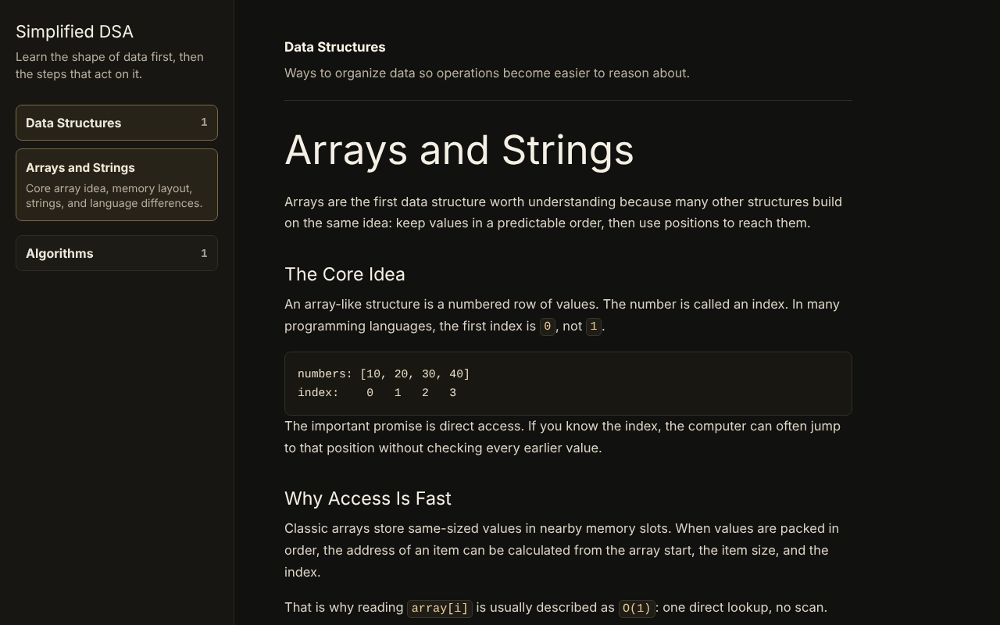
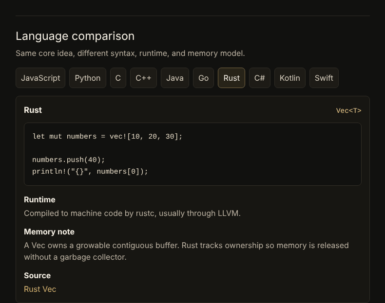
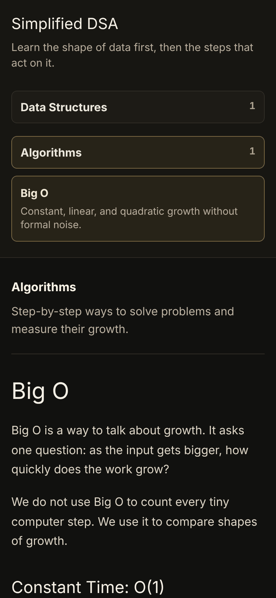
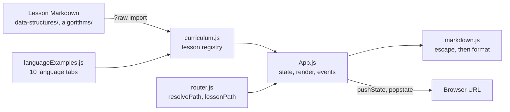

<div align="center">

# Simplified DSA

Beginner lessons on data structures and algorithms, with one array example compared across 10 programming languages.

[](https://github.com/tahmidbintaslim/Simplified-DSA/actions/workflows/ci.yml)
[](./LICENSE)
[](./LICENSE-CONTENT)
[](https://github.com/tahmidbintaslim/Simplified-DSA/commits/main)
[](https://dsa.tahmid.space)
[](https://github.com/tahmidbintaslim/Simplified-DSA/stargazers)

**[Live demo](https://dsa.tahmid.space)** · [Quick start](#quick-start) · [Contributing](#contributing)

</div>

Beginner lessons on data structures and algorithms, written in Markdown, with one array example compared across 10 programming languages. Built with Vite and plain JavaScript.

**Live demo:** [dsa.tahmid.space](https://dsa.tahmid.space). It is an early learning project with 9 lessons, each with an interactive demo.



| Language comparison tabs | Phone layout |
| --- | --- |
|  |  |

## Quick start

You need Node.js 22.14 or newer and pnpm 11 (`corepack enable`). Details are in [Prerequisites](#prerequisites).

```bash
git clone https://github.com/tahmidbintaslim/Simplified-DSA.git
cd Simplified-DSA
pnpm install --frozen-lockfile
pnpm dev        # http://localhost:3000/
pnpm test       # 13 unit tests
```

## Contents

- [Quick start](#quick-start)
- [Features](#features)
- [Goals](#goals)
- [Tech stack](#tech-stack)
- [Architecture](#architecture)
- [Getting started](#getting-started)
- [Deployment](#deployment)
- [AI tutor](#ai-tutor)
- [Project structure](#project-structure)
- [Status and roadmap](#status-and-roadmap)
- [Known limitations](#known-limitations)
- [Contributing](#contributing)
- [Security](#security)
- [License](#license)

## Features

- **9 lessons:** Arrays and Strings, Linked Lists, Stacks and Queues, Hash Tables and Binary Search Trees (Data Structures); Big O, Binary Search, Sorting and Graph Traversal (Algorithms).
- **An interactive demo on every lesson** (`src/demos/`): shift values in an array, walk a linked list, push and pop, hash keys into buckets, build and search a tree, compare growth rates, and step through binary search, four sorting algorithms and BFS versus DFS on a grid you can draw walls on. Algorithm demos have Back, Play, Step and a speed control, and a caption that explains every step.
- **Language comparison tabs** on the Arrays lesson: the same array in JavaScript, Python, C, C++, Java, Go, Rust, C#, Kotlin and Swift. Each tab has a runtime note, a memory note and a link to the source checked. The tabs follow the ARIA tabs pattern, so arrow keys, Home and End move between them.
- **A URL per lesson**, such as `/algorithms/big-o`. Refresh, shared links and the back and forward buttons all open the right lesson. Unknown URLs fall back to the first lesson.
- **A small Markdown renderer** (`src/utils/markdown.js`) that escapes HTML before it formats anything, so lesson text cannot inject markup. Only `http` and `https` links become anchors.
- **Responsive layout:** at 760px and narrower, the lesson list stacks above the lesson, and wide code blocks scroll sideways inside their own box.
- **Unit tests** for the Markdown renderer, the URL helpers and the demo algorithms, run with Node's built-in test runner.

- **An MCP server** (`mcp/server.js`) that gives AI assistants the lessons and exact step-by-step traces from the same code the demos run, plus a `dsa-tutor` Claude skill (`.claude/skills/dsa-tutor/`). See [AI tutor](#ai-tutor).

Not built yet: quizzes and a code runner. See [Status and roadmap](#status-and-roadmap).

## Goals

The project has two learning goals. The app covers a small part of the first one today.

1. Help end users learn DSA, memory, language runtimes, compiler/interpreter ideas, CPU/RAM basics, and operating-system connections through clear explanations and interactive practice.
2. Help contributors learn JavaScript, OOP, clean code, CSS, documentation, and deployment by working inside a small real project.

## Tech stack

| Area | Choice |
| --- | --- |
| Build tool and dev server | Vite 8 |
| UI | Plain JavaScript (ES modules and one `App` class), hand-written CSS |
| CSS reset | Tailwind CSS v4, used only for its base reset (preflight). Class scanning is off (`source(none)`), so it generates no utility classes |
| Content | Markdown files, imported as text with Vite's `?raw` suffix |
| Tests | Node's built-in test runner (`node --test`) |
| Package manager | pnpm 11 (pinned in `package.json` `packageManager`) |
| Hosting | Vercel |

There is no framework, no backend and no runtime dependency. The production bundle is about 19 KB of JavaScript (7 KB gzipped) and 9 KB of CSS.

## Architecture

The site is one HTML page with no server code. `App` reads the lesson registry, picks a lesson from the URL and renders it into `#app`.



- `src/core/router.js` turns a pathname into a section and lesson that exist. It has no DOM access, so the tests import it directly.
- `src/core/App.js` keeps the active section, lesson and language, re-renders on change, and restores keyboard focus after each render.
- On Vercel, `vercel.json` rewrites every path to `index.html`, so a lesson URL works on refresh.

## Getting started

### Prerequisites

- Node.js 22.14 or newer (CI uses Node 22). pnpm 11 needs Node 22.13+, and 22.14 is the first 22.x release whose bundled Corepack can verify pnpm 11's signature.
- pnpm 11. Run `corepack enable` once and Corepack uses the version pinned in `package.json`. Node 25 and newer no longer bundle Corepack, so run `npm install -g corepack` first.

No environment variables are needed. The app has no backend, API keys or `.env` file.

### Install and run

```bash
git clone https://github.com/tahmidbintaslim/Simplified-DSA.git
cd Simplified-DSA
pnpm install --frozen-lockfile
pnpm dev
```

Open http://localhost:3000/. Each lesson lives at `/<section>/<lesson>`, for example http://localhost:3000/algorithms/big-o.

### Test

```bash
pnpm test
```

### Build and preview

```bash
pnpm build     # writes the production site to dist/
pnpm preview   # serves dist/ at http://localhost:4173/
```

CI (`.github/workflows/ci.yml`) runs `pnpm install --frozen-lockfile`, `pnpm test` and `pnpm build` on every push and pull request to `main`.

## Deployment

The site is deployed on Vercel through its GitHub integration:

- Every push to `main` deploys to production at [dsa.tahmid.space](https://dsa.tahmid.space).
- Other branches and pull requests get preview deployments.

`vercel.json` sets the build command (`pnpm run build`), the output directory (`dist`) and the rewrite to `index.html`. To make a preview deployment by hand:

```bash
pnpm dlx vercel deploy -y --target preview
```

Use production deploys only when the team agrees.

## AI tutor

`mcp/server.js` is a [Model Context Protocol](https://modelcontextprotocol.io/) server. It exposes every lesson as a `dsa://<section>/<lesson>` resource and these read-only tools:

- `list_lessons`, `get_lesson`
- `trace_sort` (bubble, selection, insertion, merge), `trace_binary_search`, `trace_graph_search` (BFS or DFS on a grid), `trace_hash`, `trace_bst`

The traces come from `src/demos/algorithms.js`, so an assistant quotes the same steps the website shows instead of guessing them.

### Install the Claude Code plugin

The `plugin/` folder is a Claude Code plugin with the MCP server (bundled, no install step), the `dsa-tutor` skill and three commands. Inside Claude Code, run:

```text
/plugin install simplified-dsa --marketplace tahmidbintaslim/Simplified-DSA
```

Then try:

- `/simplified-dsa:trace merge 5 2 9 1`: exact steps, then why it costs what it costs.
- `/simplified-dsa:quiz hash-tables`: five questions, one at a time.
- `/simplified-dsa:explain-cost src/core/router.js`: the Big O of real code and the line that sets it.
- Or just ask "teach me binary search trees" and the `dsa-tutor` skill takes over.

The plugin runs the server with the `node` on your machine (Node 18 or newer).

### Use it inside this repository

Open the repository in Claude Code and approve the `simplified-dsa` server from `.mcp.json`; the `dsa-tutor` skill loads from `.claude/skills/` (a link to `plugin/skills/`). Then ask, for example, "teach me hash tables" or "quiz me on BFS vs DFS". Other MCP clients can start the server with:

```bash
pnpm mcp
```

## Project structure

```text
src/
  main.js                  Browser entry point
  style.css                App styles
  core/
    App.js                 App state, rendering and events
    router.js              Lesson URL helpers (no DOM, unit tested)
  content/
    curriculum.js          Lesson registry: sections, lessons, Markdown imports
    languageExamples.js    The 10 language tabs for the Arrays lesson
    data-structures/       Data structure lessons (Markdown)
    algorithms/            Algorithm lessons (Markdown)
    CURRICULUM.md          Planned lesson order and writing rules (not rendered)
    chapters/02-Arrays.md  Legacy note kept from the old layout (not rendered)
  demos/
    algorithms.js          Pure step generators for the demos (no DOM, unit tested)
    player.js              Back / Play / Step controls shared by algorithm demos
    index.js               One mount function per demo, keyed by the lesson's `demo` id
  utils/
    markdown.js            Small Markdown-to-HTML renderer
mcp/server.js              MCP server: lessons and algorithm traces for AI assistants
plugin/                    Claude Code plugin: bundled server, dsa-tutor skill, /trace /quiz /explain-cost
.claude-plugin/            Marketplace file, so the plugin installs from this repository
scripts/build-plugin.js    Bundles mcp/server.js into plugin/server (pnpm build:plugin)
tests/                     node:test files for markdown.js, router.js, the demo algorithms and the MCP server
docs/                      Contributor guides and README screenshots
vercel.json                Vercel build settings and the SPA rewrite
```

## Status and roadmap

This is an early learning project. The shell, 9 lessons with interactive demos, the language tabs and lesson URLs work. Everything else below is planned, not built.

Next, from the [Project Plan](./PLAN.md) and [`CURRICULUM.md`](./src/content/CURRICULUM.md):

- More Data Structures lessons: Heaps, Tries, Graph representations.
- More Algorithms lessons: Recursion, Quicksort, Two Pointers, Sliding Window, Dijkstra.
- Quizzes and progress tracking. See [Strategy](./docs/STRATEGY.md) for the product plan.
- A browser code editor, after safe execution and language support are defined.

## Known limitations

These follow from the code as it is today:

- The language comparison tabs exist only on the Arrays and Strings lesson.
- There are no quizzes or code runner yet. Code samples are read-only text.
- The hash table demo uses a sum-of-character-codes hash on purpose, so collisions are easy to see. Real hash functions mix bits far better.
- The Markdown renderer (`src/utils/markdown.js`) handles only the syntax the lessons use: `#` and `##` headings, `- ` bullet lists, fenced code blocks, inline code, bold text and `http`/`https` links. Tables, numbered lists, images and deeper headings are not rendered as Markdown.
- Code blocks have no syntax highlighting.
- An unknown lesson URL opens the first lesson instead of a "not found" page.
- The tests cover the Markdown renderer, the URL helpers and the demo algorithms. The demo UIs have no automated browser tests.

## Contributing

Contributions are welcome, and the codebase is written to be read by beginners. Start with:

- [Contributor Guide](./docs/CONTRIBUTING.md): working rules, commits, adding a lesson, deploy previews
- [JavaScript and OOP Guide](./docs/JS_OOP_GUIDE.md)
- [CSS Guide](./docs/CSS_GUIDE.md)
- [Content Guide](./docs/CONTENT_GUIDE.md) and [Language Comparison Guide](./docs/LANGUAGE_COMPARISON_GUIDE.md)
- [Sources and Learnings](./docs/SOURCES_AND_LEARNINGS.md) and [Learning Experience Guide](./docs/LEARNING_EXPERIENCE.md)

Run `pnpm test` and `pnpm build` before opening a pull request. Questions and review notes on the code and docs go in [issue #1](https://github.com/tahmidbintaslim/Simplified-DSA/issues/1).

Bug reports and feature ideas use the [issue forms](https://github.com/tahmidbintaslim/Simplified-DSA/issues/new/choose). Pull requests get a short checklist from the [pull request template](./.github/pull_request_template.md).

## Security

Please report security problems privately, not in a public issue. See [SECURITY.md](./SECURITY.md).

## License

- Code (the app and every code example, including snippets inside lessons) is under the [MIT License](./LICENSE).
- Lesson text (the Markdown files in `src/content/` and the prose notes in `src/content/languageExamples.js`) is under [CC BY 4.0](./LICENSE-CONTENT). You can reuse and adapt it with credit.

By contributing, you agree that your code is licensed under MIT and your lesson text under CC BY 4.0.
