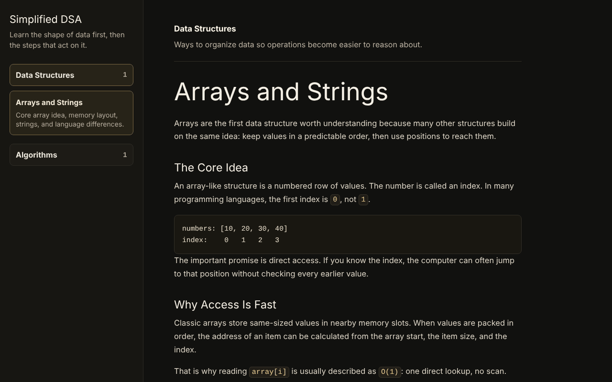
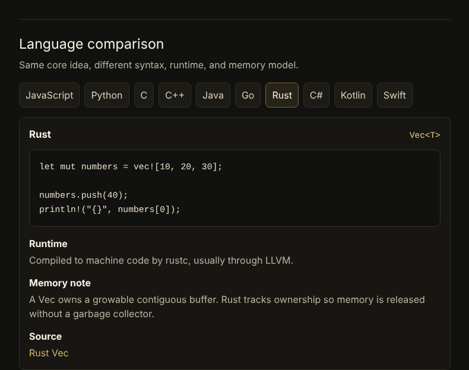
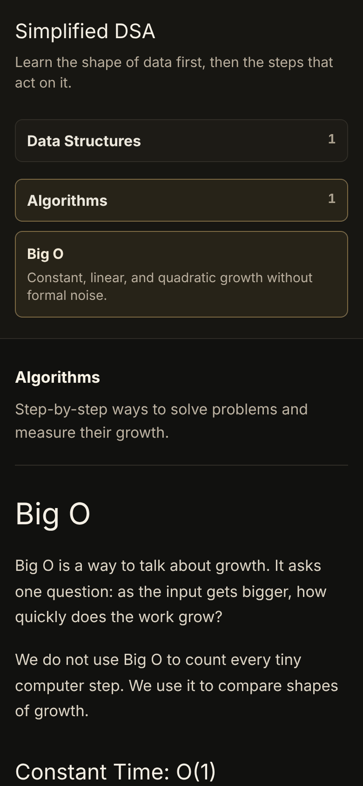

<div align="center">

# Simplified DSA

Beginner lessons on data structures and algorithms, with one array example compared across 10 programming languages.

[](https://github.com/tahmidbintaslim/Simplified-DSA/actions/workflows/ci.yml)
[](./LICENSE)
[](https://github.com/tahmidbintaslim/Simplified-DSA/commits/main)
[](https://dsa.tahmid.space)

**[Live demo](https://dsa.tahmid.space)** · [Quick start](#quick-start)

</div>

Beginner lessons on data structures and algorithms, written in Markdown, with one array example compared across 10 programming languages. Built with Next.js, React and Clerk. Free to use with a free account; the source is closed.

**Live demo:** [dsa.tahmid.space](https://dsa.tahmid.space). It is an early learning project with 13 lessons, each with an interactive demo.



| Language comparison tabs | Phone layout |
| --- | --- |
|  |  |

## Quick start

You need Node.js 22.14 or newer and pnpm 11 (`corepack enable`). Details are in [Prerequisites](#prerequisites).

```bash
pnpm install --frozen-lockfile
pnpm dev        # http://localhost:3000/
pnpm test       # unit tests
pnpm test:e2e   # browser tests: builds, then drives the site in Chromium
```

## Contents

- [Quick start](#quick-start)
- [Features](#features)
- [Goals](#goals)
- [Tech stack](#tech-stack)
- [Architecture](#architecture)
- [Getting started](#getting-started)
- [Deployment](#deployment)
- [AI tutor](#ai-tutor)
- [Project structure](#project-structure)
- [Status and roadmap](#status-and-roadmap)
- [Known limitations](#known-limitations)
- [Contributing](#contributing)
- [Security](#security)
- [License](#license)

## Features

- **13 lessons:** Arrays and Strings, Linked Lists, Stacks and Queues, Hash Tables and Binary Search Trees (Data Structures); Big O, Binary Search, Sorting and Graph Traversal (Algorithms); Two Pointers, Sliding Window, Fast and Slow Pointers and Prefix Sums (Interview Patterns).
- **Lessons built for complete beginners:** each one opens with an everyday analogy, traces a small example step by step with drawn arrays and pointer labels, asks quick quizzes with instant feedback, and ends with when-to-use signals, a cost table and common mistakes. A header lists the level, the time and what you will be able to do; you can mark lessons complete (stored only in your browser) and move to the previous or next one.
- **An interactive demo on every lesson** (`src/demos/`), placed right after the idea it shows: shift values in an array, walk a linked list, push and pop, hash keys into buckets, build and search a tree, compare growth rates, and step through binary search, four sorting algorithms and BFS versus DFS on a grid you can draw walls on. Algorithm demos have Back, Play, Step, a speed control and arrow-key stepping, a caption for every step, the pseudocode with the running line highlighted, a live variables panel, and your own input.
- **Language comparison tabs** on the Arrays lesson: the same array in JavaScript, Python, C, C++, Java, Go, Rust, C#, Kotlin and Swift. Each tab has a runtime note, a memory note and a link to the source checked. The tabs follow the ARIA tabs pattern, so arrow keys, Home and End move between them.
- **A URL per lesson**, such as `/algorithms/big-o`. Refresh, shared links and the back and forward buttons all open the right lesson. Unknown URLs show a "Page not found" message with the lesson list.
- **Share and search basics:** link-preview tags and image, a per-lesson meta description, `robots.txt`, a `sitemap.xml` generated from the lesson files, and a [privacy page](https://dsa.tahmid.space/privacy.html).
- **A small Markdown renderer** (`src/utils/markdown.js`) that escapes HTML before it formats anything, so lesson text cannot inject markup. Only `http` and `https` links become anchors.
- **Responsive layout:** at 760px and narrower, the lesson list stacks above the lesson, and wide code blocks scroll sideways inside their own box.
- **Unit tests** for the Markdown renderer, the URL helpers and the demo algorithms, run with Node's built-in test runner.

- **An MCP server** (`mcp/server.js`) that gives AI assistants the lessons and exact step-by-step traces from the same code the demos run, plus a `dsa-tutor` Claude skill (`.claude/skills/dsa-tutor/`). See [AI tutor](#ai-tutor).

Not built yet: quizzes and a code runner. See [Status and roadmap](#status-and-roadmap).

## Goals

The project has two learning goals. The app covers a small part of the first one today.

1. Help end users learn DSA, memory, language runtimes, compiler/interpreter ideas, CPU/RAM basics, and operating-system connections through clear explanations and interactive practice.
2. Help contributors learn JavaScript, OOP, clean code, CSS, documentation, and deployment by working inside a small real project.

## Tech stack

| Area | Choice |
| --- | --- |
| Framework | Next.js 16 (App Router) with React 19 |
| Sign-in | Clerk (`@clerk/nextjs`). The home page is public; every lesson needs an account |
| Analytics | PostHog, loaded only after the learner allows it (consent banner) |
| Styling | Hand-written CSS on design tokens: Stripe-style light theme, Vercel Geist dark theme. Tailwind v4 for the reset only |
| Animation | Motion (motion.dev) springs for demos, worked examples and widgets |
| Practice | Simulators (`/[lang]/simulators`) run each demo full size with missions (`src/demos/missions.js`); quizzes (`/[lang]/quizzes`) run a lesson's quiz blocks one by one with a score |
| Languages | English (`/en/...`) and Bangla (`/bn/...`). Interface text in `lib/i18n.js`; Bangla lessons in `src/content/bn/`, falling back to English until translated |
| Content | Markdown lessons in `src/content/`, rendered on the server |
| Database | Neon Postgres (`@neondatabase/serverless`): curated resource library, synced progress, quiz attempts. Schema in `db/schema.sql` |
| AI tutor | MCP server (`mcp/server.js`), served at `/mcp` and bundled in the Claude Code plugin |
| Tests | Node's test runner; Playwright with `@clerk/testing` for the browser suite |
| Hosting | Vercel |

## Architecture

- `proxy.js` sends `/` to `/en` or `/bn` (cookie, then browser language) and moves old `/section/lesson` links under `/en`.
- `app/[lang]/[section]/[lesson]/page.js` checks the Clerk session (signed out → `/sign-in`), reads the lesson Markdown and builds the article HTML on the server (`lib/lessons.js`).
- `components/LessonView.js` mounts the live parts into that article on the client: the demo, widgets, scrubbable worked examples, quizzes and "On this page".
- `proxy.js` runs Clerk's middleware on every request. `app/mcp/route.js` is the public MCP connector.
- `components/Analytics.js` asks for consent, then sends `lesson_viewed`, `demo_used`, `quiz_answered` and `lesson_completed` to PostHog, identified by Clerk user id.

## Getting started

### Prerequisites

- Node.js 22.14 or newer (CI uses Node 22). pnpm 11 needs Node 22.13+, and 22.14 is the first 22.x release whose bundled Corepack can verify pnpm 11's signature.
- pnpm 11. Run `corepack enable` once and Corepack uses the version pinned in `package.json`. Node 25 and newer no longer bundle Corepack, so run `npm install -g corepack` first.

Create `.env.local` (never commit it) with:

```bash
NEXT_PUBLIC_CLERK_PUBLISHABLE_KEY=pk_test_...
CLERK_SECRET_KEY=sk_test_...
# Optional: Neon Postgres. Without it there is no resources panel and progress stays in the browser.
DATABASE_URL=postgresql://...
# Optional: analytics. Without it nothing is tracked.
NEXT_PUBLIC_POSTHOG_KEY=phc_...
NEXT_PUBLIC_POSTHOG_HOST=https://eu.i.posthog.com
```

### Install and run

```bash
pnpm install --frozen-lockfile
pnpm dev
```

Open http://localhost:3000/. Each lesson lives at `/<section>/<lesson>`, for example http://localhost:3000/algorithms/big-o.

### Test

```bash
pnpm db:migrate  # create tables (safe to re-run)
pnpm db:seed     # load the resource library from db/resources.js
pnpm test        # unit tests
pnpm test:e2e    # builds, then runs the browser suite signed in as the Clerk test user
```

The browser suite signs in as `e2e+clerk_test@example.com` (override with `E2E_CLERK_USER_EMAIL`), a user in the Clerk development instance, so it needs the Clerk keys in its environment. In CI they come from the repository secrets `CLERK_PUBLISHABLE_KEY` and `CLERK_SECRET_KEY`.

## Deployment

Vercel deploys `main` to production at [dsa.tahmid.space](https://dsa.tahmid.space); pull requests get preview deployments. The Vercel project needs the same environment variables as `.env.local`, with Clerk production keys for production.

## AI tutor

`mcp/server.js` is a [Model Context Protocol](https://modelcontextprotocol.io/) server. It exposes every lesson as a `dsa://<section>/<lesson>` resource and these read-only tools:

- `list_lessons`, `get_lesson`
- `trace_sort` (bubble, selection, insertion, merge), `trace_binary_search`, `trace_graph_search` (BFS or DFS on a grid), `trace_hash`, `trace_bst`, `trace_two_pointers`, `trace_sliding_window`, `trace_fast_slow`, `trace_prefix_sums`

The traces come from `src/demos/algorithms.js`, so an assistant quotes the same steps the website shows instead of guessing them.

### Install the Claude Code plugin

The `plugin/` folder is a Claude Code plugin with the MCP server (bundled, no install step), the `dsa-tutor` skill and three commands. Inside Claude Code, run:

```text
/plugin install simplified-dsa --marketplace tahmidbintaslim/Simplified-DSA
```

Then try:

- `/simplified-dsa:trace merge 5 2 9 1`: exact steps, then why it costs what it costs.
- `/simplified-dsa:quiz hash-tables`: five questions, one at a time.
- `/simplified-dsa:explain-cost src/demos/algorithms.js`: the Big O of real code and the line that sets it.
- Or just ask "teach me binary search trees" and the `dsa-tutor` skill takes over.

The plugin runs the server with the `node` on your machine (Node 18 or newer).

### Use it inside this repository

Open the repository in Claude Code and approve the `simplified-dsa` server from `.mcp.json`; the `dsa-tutor` skill loads from `.claude/skills/` (a link to `plugin/skills/`). Then ask, for example, "teach me hash tables" or "quiz me on BFS vs DFS".

### Add it to Claude as a connector

The same server runs as a stateless HTTPS endpoint (`api/mcp.js`, a Vercel function) at `https://dsa.tahmid.space/mcp`. In claude.ai: Customize → Connectors → Add custom connector → paste that URL, no sign-in. Any MCP client that speaks Streamable HTTP can use it.

Other MCP clients can also start the server locally with:

```bash
pnpm mcp
```

## Project structure

```text
app/
  layout.js                Shell: Clerk provider, header, footer, consent banner
  page.js                  Public home page
  [section]/[lesson]/      A lesson (sign-in required)
  sign-in/, sign-up/       Clerk sign-in pages
  mcp/route.js             Public MCP connector
components/                React components: LessonView, Sidebar, Home, HeroFigure, Analytics…
lib/lessons.js             Finds lessons and builds the article HTML on the server
proxy.js                   Clerk middleware
src/
  style.css                Design tokens (Stripe light, Geist dark) and styles
  core/                    Progress storage and scrubbable worked examples
  content/                 Lesson registry and Markdown lessons
  demos/                   Step generators, the player, Motion helpers, one mount per demo
  widgets/                 Inline teaching widgets (guess game, halving, bug lab)
  utils/                   Markdown renderer and icons
mcp/server.js              MCP server: lessons and algorithm traces for AI assistants
plugin/                    Claude Code plugin: bundled server, dsa-tutor skill, commands
scripts/build-plugin.js    Bundles mcp/server.js into plugin/server (pnpm build:plugin)
tests/                     Unit tests (renderer, progress, demo algorithms, MCP server)
e2e/                       Browser tests (pnpm test:e2e)
```

## Status and roadmap

This is an early learning project. The shell, 13 lessons with interactive demos, the language tabs and lesson URLs work. Everything else below is planned, not built.

Next, from the [Project Plan](./PLAN.md) and [`CURRICULUM.md`](./src/content/CURRICULUM.md):

- More Data Structures lessons: Heaps, Tries, Graph representations.
- More Algorithms lessons: Recursion, Quicksort, Dijkstra.
- More Interview Patterns: Backtracking, Dynamic Programming.
- Quizzes and progress tracking. See [Strategy](./docs/STRATEGY.md) for the product plan.
- The [practice companion browser extension](./docs/LEETCODE_COMPANION.md).
- A browser code editor, after safe execution and language support are defined.

## Known limitations

These follow from the code as it is today:

- The language comparison tabs exist only on the Arrays and Strings lesson.
- There are no quizzes or code runner yet. Code samples are read-only text.
- The hash table demo uses a sum-of-character-codes hash on purpose, so collisions are easy to see. Real hash functions mix bits far better.
- The Markdown renderer (`src/utils/markdown.js`) handles only the syntax the lessons use (listed in the [content guide](./docs/CONTENT_GUIDE.md#markdown-support)). Images, italics and nested lists are not supported.
- Code blocks have no syntax highlighting.
- Unknown URLs show a "Page not found" message, but Vercel still answers them with HTTP 200, because every path is served by the single-page app.
- Browser tests (`e2e/`) cover rendering, quizzes, the step player, progress, navigation, storage-blocked browsers and phone layout in Chromium only, not Firefox or Safari.

## Contributing

Simplified DSA is closed source. Issues and pull requests are by invitation. Working notes for collaborators are in [docs/](./docs/).

## Security

Please report security problems privately, not in a public issue. See [SECURITY.md](./SECURITY.md).

## License

Proprietary. All rights reserved. See [LICENSE](./LICENSE). Using the hosted site and the public MCP connector is free.

