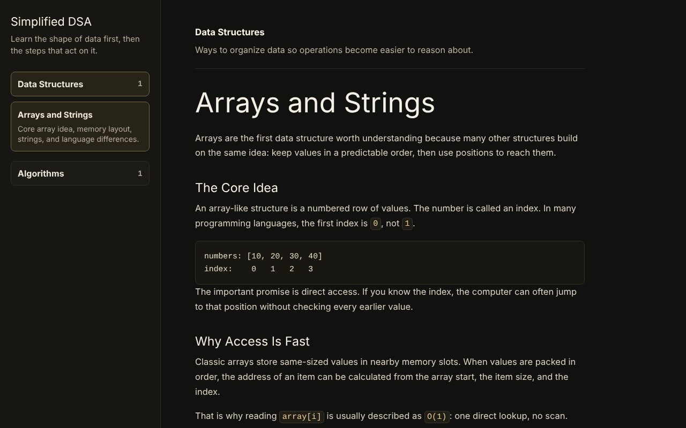
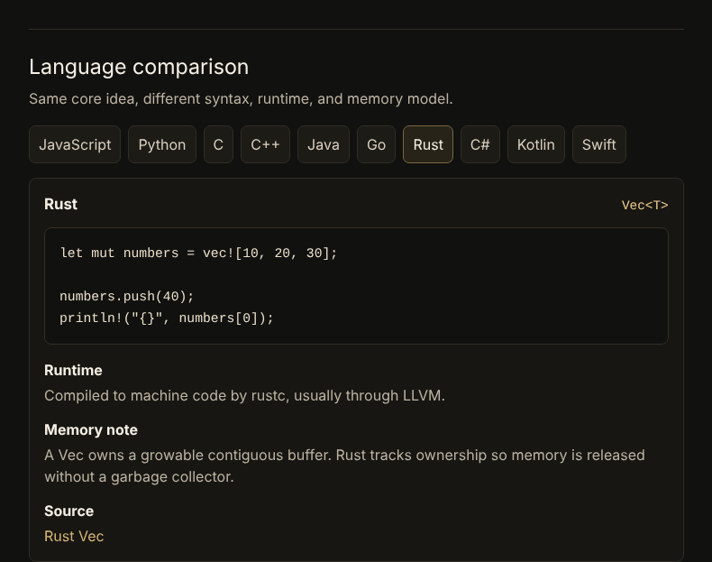
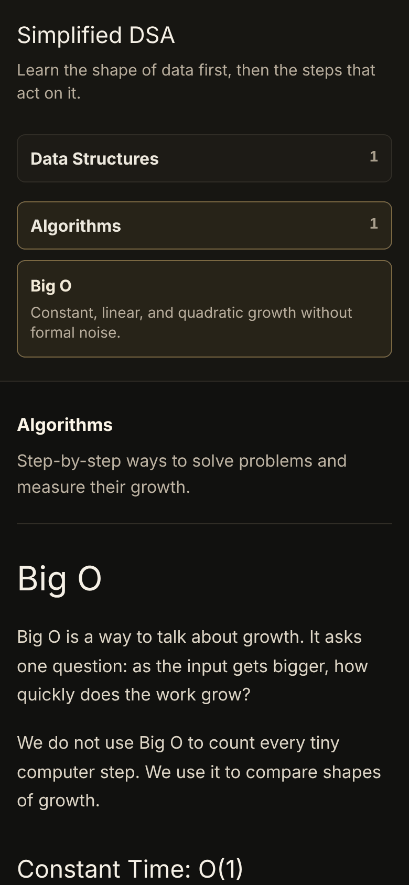
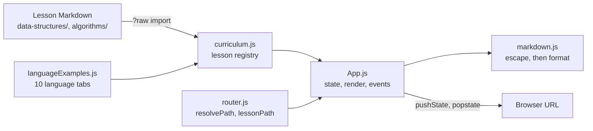

# Simplified DSA

[](https://github.com/tahmidbintaslim/Simplified-DSA/actions/workflows/ci.yml)
[](https://dsa.tahmid.space)
[](./LICENSE)
[](./LICENSE-CONTENT)

Beginner lessons on data structures and algorithms, written in Markdown, with one array example compared across 10 programming languages. Built with Vite and plain JavaScript.

**Live demo:** [dsa.tahmid.space](https://dsa.tahmid.space). It is an early learning project with 2 lessons so far.



| Language comparison tabs | Phone layout |
| --- | --- |
|  |  |

## Features

- **2 lessons:** Arrays and Strings (Data Structures) and Big O (Algorithms).
- **Language comparison tabs** on the Arrays lesson: the same array in JavaScript, Python, C, C++, Java, Go, Rust, C#, Kotlin and Swift. Each tab has a runtime note, a memory note and a link to the source checked. The tabs follow the ARIA tabs pattern, so arrow keys, Home and End move between them.
- **A URL per lesson**, such as `/algorithms/big-o`. Refresh, shared links and the back and forward buttons all open the right lesson. Unknown URLs fall back to the first lesson.
- **A small Markdown renderer** (`src/utils/markdown.js`) that escapes HTML before it formats anything, so lesson text cannot inject markup. Only `http` and `https` links become anchors.
- **Responsive layout:** at 760px and narrower, the lesson list stacks above the lesson, and wide code blocks scroll sideways inside their own box.
- **13 unit tests** for the Markdown renderer and the URL helpers, run with Node's built-in test runner.

Not built yet: more lessons, visualizers, quizzes and a code runner. See [Status and roadmap](#status-and-roadmap).

## Goals

The project has two learning goals. The app covers a small part of the first one today.

1. Help end users learn DSA, memory, language runtimes, compiler/interpreter ideas, CPU/RAM basics, and operating-system connections through clear explanations and interactive practice.
2. Help contributors learn JavaScript, OOP, clean code, CSS, documentation, and deployment by working inside a small real project.

## Tech stack

| Area | Choice |
| --- | --- |
| Build tool and dev server | Vite 8 |
| UI | Plain JavaScript (ES modules and one `App` class), hand-written CSS |
| CSS reset | Tailwind CSS v4, used only for its base reset (preflight). Class scanning is off (`source(none)`), so it generates no utility classes |
| Content | Markdown files, imported as text with Vite's `?raw` suffix |
| Tests | Node's built-in test runner (`node --test`) |
| Package manager | pnpm 11 (pinned in `package.json` `packageManager`) |
| Hosting | Vercel |

There is no framework, no backend and no runtime dependency. The production bundle is about 19 KB of JavaScript (7 KB gzipped) and 9 KB of CSS.

## Architecture

The site is one HTML page with no server code. `App` reads the lesson registry, picks a lesson from the URL and renders it into `#app`.



- `src/core/router.js` turns a pathname into a section and lesson that exist. It has no DOM access, so the tests import it directly.
- `src/core/App.js` keeps the active section, lesson and language, re-renders on change, and restores keyboard focus after each render.
- On Vercel, `vercel.json` rewrites every path to `index.html`, so a lesson URL works on refresh.

## Getting started

### Prerequisites

- Node.js 20.19+ or 22.12+ (Vite 8's requirement). CI uses Node 22.
- pnpm 11. Run `corepack enable` once and Corepack uses the version pinned in `package.json`.

No environment variables are needed. The app has no backend, API keys or `.env` file.

### Install and run

```bash
git clone https://github.com/tahmidbintaslim/Simplified-DSA.git
cd Simplified-DSA
pnpm install --frozen-lockfile
pnpm dev
```

Open http://localhost:3000/. Each lesson lives at `/<section>/<lesson>`, for example http://localhost:3000/algorithms/big-o.

### Test

```bash
pnpm test
```

### Build and preview

```bash
pnpm build     # writes the production site to dist/
pnpm preview   # serves dist/ at http://localhost:4173/
```

CI (`.github/workflows/ci.yml`) runs `pnpm install --frozen-lockfile`, `pnpm test` and `pnpm build` on every push and pull request to `main`.

## Deployment

The site is deployed on Vercel through its GitHub integration:

- Every push to `main` deploys to production at [dsa.tahmid.space](https://dsa.tahmid.space).
- Other branches and pull requests get preview deployments.

`vercel.json` sets the build command (`pnpm run build`), the output directory (`dist`) and the rewrite to `index.html`. To make a preview deployment by hand:

```bash
pnpm dlx vercel deploy -y --target preview
```

Use production deploys only when the team agrees.

## Project structure

```text
src/
  main.js                  Browser entry point
  style.css                App styles
  core/
    App.js                 App state, rendering and events
    router.js              Lesson URL helpers (no DOM, unit tested)
  content/
    curriculum.js          Lesson registry: sections, lessons, Markdown imports
    languageExamples.js    The 10 language tabs for the Arrays lesson
    data-structures/       Data structure lessons (Markdown)
    algorithms/            Algorithm lessons (Markdown)
    CURRICULUM.md          Planned lesson order and writing rules (not rendered)
    chapters/02-Arrays.md  Legacy note kept from the old layout (not rendered)
  utils/
    markdown.js            Small Markdown-to-HTML renderer
tests/                     node:test files for markdown.js and router.js
docs/                      Contributor guides and README screenshots
vercel.json                Vercel build settings and the SPA rewrite
```

## Status and roadmap

This is an early learning project. The shell, 2 lessons, the language tabs and lesson URLs work and are deployed. Everything else below is planned, not built.

Next, from the [Project Plan](./PLAN.md) and [`CURRICULUM.md`](./src/content/CURRICULUM.md):

- More Data Structures lessons: Linked Lists, Stacks and Queues, Hash Tables, Trees, Heaps, Graphs.
- More Algorithms lessons: Searching, Sorting, Recursion, Two Pointers, Sliding Window, BFS, DFS.
- A first small interactive visualizer, once the written lessons feel right.
- A browser code editor, after safe execution and language support are defined.

## Contributing

Contributions are welcome, and the codebase is written to be read by beginners. Start with:

- [Contributor Guide](./docs/CONTRIBUTING.md): working rules, commits, adding a lesson, deploy previews
- [JavaScript and OOP Guide](./docs/JS_OOP_GUIDE.md)
- [CSS Guide](./docs/CSS_GUIDE.md)
- [Content Guide](./docs/CONTENT_GUIDE.md) and [Language Comparison Guide](./docs/LANGUAGE_COMPARISON_GUIDE.md)
- [Sources and Learnings](./docs/SOURCES_AND_LEARNINGS.md) and [Learning Experience Guide](./docs/LEARNING_EXPERIENCE.md)

Run `pnpm test` and `pnpm build` before opening a pull request. Questions and review notes on the code and docs go in [issue #1](https://github.com/tahmidbintaslim/Simplified-DSA/issues/1).

## License

- Code (the app and every code example, including snippets inside lessons) is under the [MIT License](./LICENSE).
- Lesson text (the Markdown files in `src/content/` and the prose notes in `src/content/languageExamples.js`) is under [CC BY 4.0](./LICENSE-CONTENT). You can reuse and adapt it with credit.

By contributing, you agree that your code is licensed under MIT and your lesson text under CC BY 4.0.
